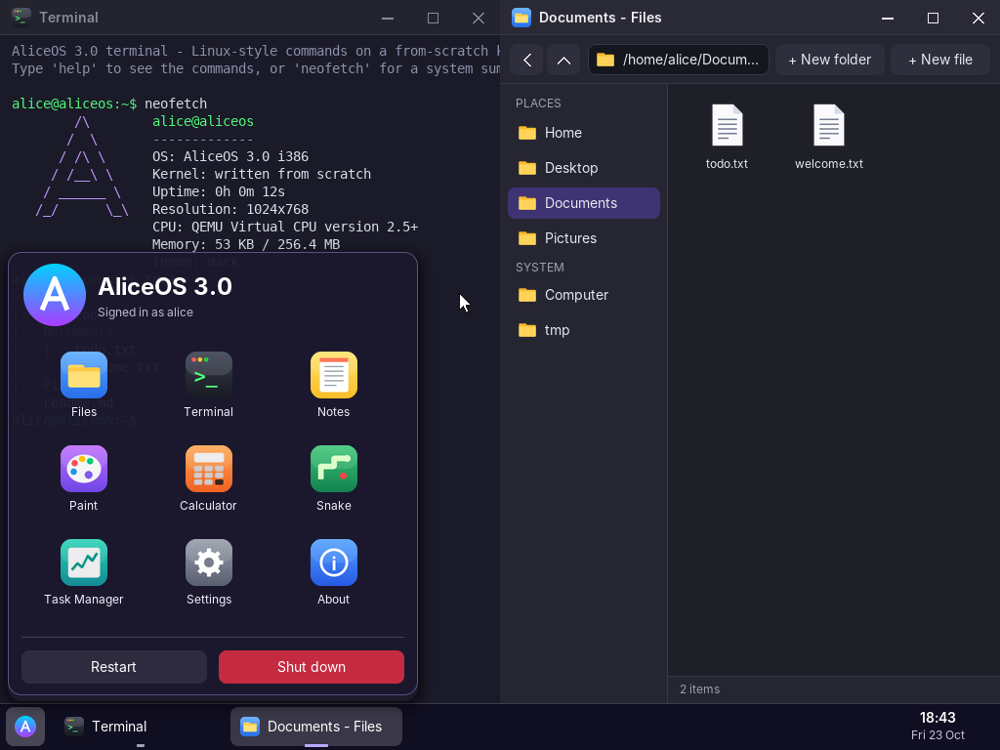

# alice-projects

Projects I built from scratch while learning: an operating system, a social photo/video app, an industrial MES, and small tools for AI agents. Everything here is built with the help of Claude (Anthropic) and tested before being published.

| Folder | Project | Live |
|---|---|---|
| [`aliceos3/`](aliceos3) | **AliceOS 3.0**: a graphical operating system written in C and x86 assembly (windows, file explorer, task manager, Linux-style shell, file system) | [aliceos.vercel.app](https://aliceos.vercel.app) |
| [`aliceos2/`](aliceos2), [`aliceos/`](aliceos) | Earlier versions (2.0 graphical, 0.1 text mode bootloader + kernel + shell) | - |
| [`lqta/`](lqta) | **Lqta**: photo, short video, stories and private messages app. Single-file vanilla JS front end on Supabase (auth, Postgres with row-level security, storage) | [lqta.vercel.app](https://lqta.vercel.app) |
| [`im-jx-smart-suite/`](im-jx-smart-suite) | **IM JX Smart Suite**: a manufacturing execution system (FastAPI, SQLite, Docker) with a static read-only demo | [demo](https://im-jx-smart-suite-demo.vercel.app) |
| [`hub/`](hub) | **Alice Hub**: a static chat page that works with any OpenAI-compatible model provider and MCP connectors, with manual approval of every tool call | [alice-hub.vercel.app](https://alice-hub.vercel.app) |
| [`mcp-lqta/`](mcp-lqta) | Read-only MCP server exposing Lqta's public data (stateless JSON-RPC on Vercel) | - |
| [`calcul-trs-mcp/`](calcul-trs-mcp) | MCP server that computes OEE (TRS) for a production line | - |
| [`apk-builder/`](apk-builder), [`games/`](games) | WebView APK template built by GitHub Actions, and a memory game | - |

## Notes
- No secrets are stored in this repository. Tokens and keys live in environment variables of the hosting platform.
- The Supabase *publishable* key in `lqta/` and `mcp-lqta/` is public by design; data access is enforced by row-level security policies.
- `im-jx-smart-suite` ships **demo** accounts (for example `admin` / `admin123`) in its seed data. Change them before deploying anywhere real.
- Each project has its own folder; some have their own README.

## License
MIT, see [LICENSE](LICENSE).
