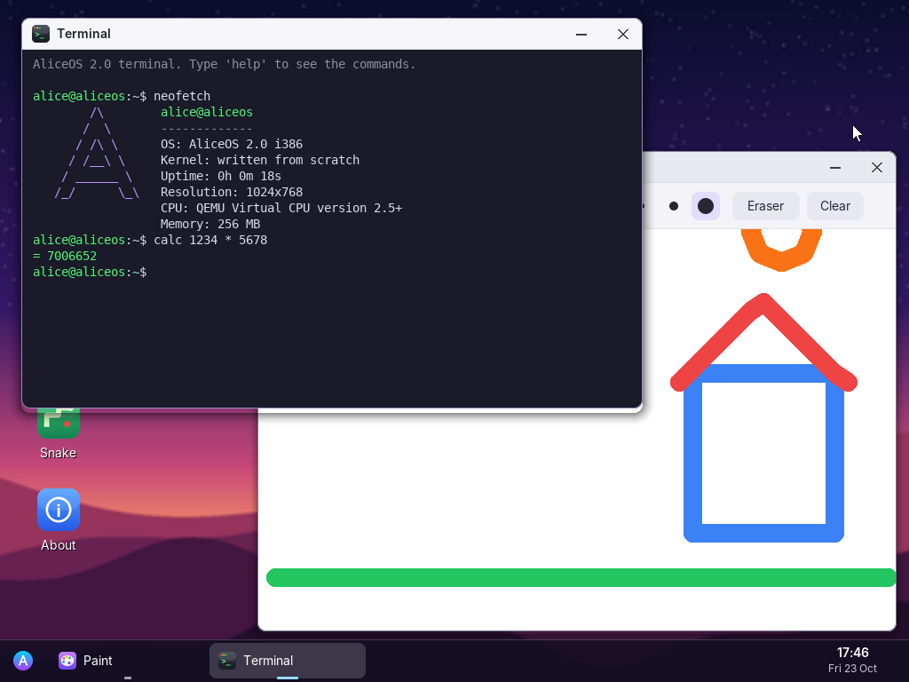

# AliceOS 2.0

A graphical operating system written from scratch in C and x86 assembly — its own kernel, drivers, window manager and apps. No Linux, no libraries.



## Features
**Kernel (32-bit, protected mode)**
- Boots through GRUB (Multiboot) on both BIOS and UEFI machines
- Interrupt table, CPU exception handler with a crash screen
- Drivers: PS/2 keyboard (Shift, Caps Lock, arrows, keypad), PS/2 mouse, PIT timer (100 Hz), real-time clock, CPUID
- Linear framebuffer graphics (1024×768, 32-bit colour) with double buffering

**Graphical interface**
- Desktop with wallpaper and icons (double-click to open)
- Windows you can move, focus, minimise and close, with shadows and rounded corners
- Taskbar with open windows, clock and date
- Start menu with apps, Restart and Shut down
- Anti-aliased text (Inter and DejaVu Sans Mono fonts) and alpha blending
- Welcome notification

**Applications**
| App | What it does |
|-----|--------------|
| Terminal | Shell with `help`, `neofetch`, `calc (12+3)*4`, `open <app>`, `date`, `uptime`, `history`, `reboot`, `shutdown` … |
| Calculator | Decimal calculator (fixed point, 6 decimals), mouse and keyboard |
| Notes | Text editor with cursor, arrows, Home/End, line numbers, status bar |
| Paint | Drawing with 12 colours, 3 brush sizes, eraser, clear |
| Snake | The classic game (arrows/WASD, P to pause, best score) |
| About | System information (CPU, memory, display, uptime) |

## Run it
**QEMU (Windows, Linux, macOS)**
```
qemu-system-i386 -cdrom aliceos.iso -m 256
```
Click inside the window to capture the mouse; press Ctrl+Alt+G to release it.

**VirtualBox**
New VM → Type "Other", Version "Other/Unknown" → 256 MB RAM → attach `aliceos.iso` as the optical drive → Start.

**Real PC (USB stick)**
Write `aliceos.iso` with Rufus in "DD image" mode, disable Secure Boot, and boot from the USB stick.
Keyboard and mouse need PS/2 or "USB legacy support" in the BIOS/UEFI settings (AliceOS has no USB driver yet).

## Build it (Linux)
```
sudo apt install nasm gcc grub-pc-bin grub-efi-amd64-bin grub-common xorriso mtools python3-pil
make          # builds aliceos.iso
make run      # runs it in QEMU
```
`tools/gen_assets.py` turns the fonts, icons and wallpaper into C arrays (`src/assets.c`).

## Source layout
| File | Role |
|------|------|
| `src/boot.asm` | Multiboot header, entry point, interrupt stubs |
| `src/kernel.c` | Interrupts, timer, clock, keyboard, mouse, power, crash screen |
| `src/gfx.c` | Framebuffer, shapes, anti-aliased text, images, cursor |
| `src/gui.c` | Window manager, desktop, taskbar, start menu, event loop |
| `src/apps.c` | The six applications |
| `src/div64.c` | 64-bit division helpers |
| `tools/gen_assets.py` | Font, icon and wallpaper generator |
| `tools/drive.py` | Automated test driver (QEMU + mouse/keyboard scripts + video recording) |

About 2,100 lines of hand-written code.

## Limits
- No file system: notes and drawings are lost at shutdown
- No USB, network or sound drivers
- No multitasking or memory protection: apps run inside the kernel
- Fixed screen size (1024×768 requested from the firmware)

## Ideas for next versions
FAT32 file system (save notes and drawings) · USB keyboard and mouse · resizable windows · a simple web page viewer · Arabic text support.

## Credits
Fonts: Inter (SIL Open Font License) and DejaVu Sans Mono (free licence), converted to bitmaps at build time.
