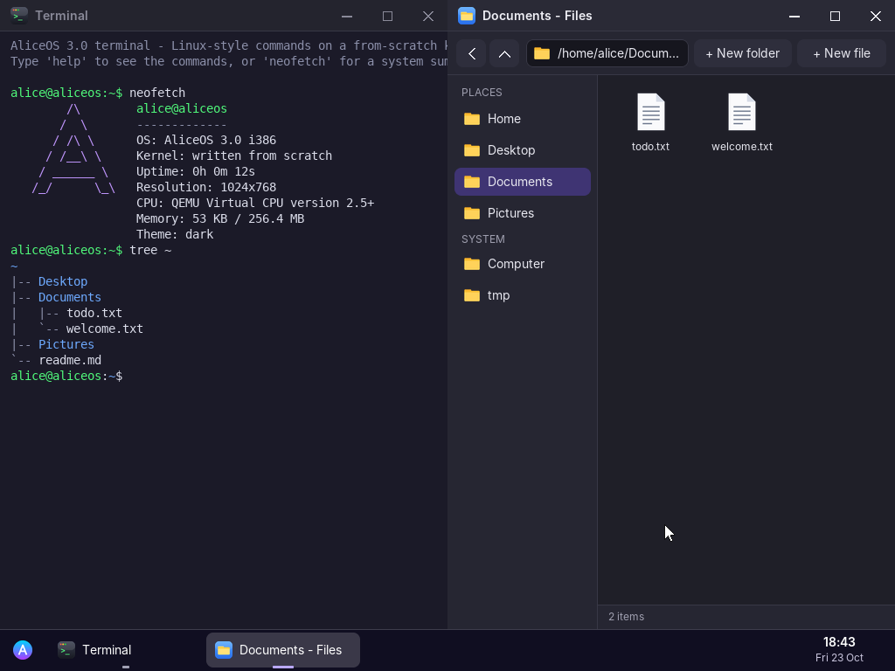

# AliceOS 3.0

A graphical operating system written from scratch in C and x86 assembly, mixing the best ideas of **Windows** (desktop, file explorer, task manager, window snapping) and **Linux** (a real shell, a `/home` file tree, ownership and permissions). No Linux kernel, no libraries.



Demo video: [`screenshots/demo.mp4`](screenshots/demo.mp4)

## What is new in 3.0
| Inspired by | Feature |
|---|---|
| Linux | In-memory file system with `/bin`, `/etc`, `/home/alice`, `/tmp`; files owned by `root` are read-only |
| Linux | Shell commands: `ls -l -a`, `cd`, `pwd`, `mkdir`, `touch`, `cat`, `rm -r`, `mv`, `cp`, `tree`, `echo`, output redirection `>` and `>>`, Tab completion, history |
| Linux | `ps`, `kill <pid>`, `free`, `df`, `uname -a`, `neofetch`, `sudo` (politely refused) |
| Windows | **Files** explorer: sidebar, back/up, path bar, new folder/file, rename (F2), delete, right-click menus, properties |
| Windows | Notes and Paint open and save files (Ctrl+S); drawings use a compressed `.aimg` format |
| Windows | Maximise, resize from the edges, double-click title to maximise, **snap** to the left/right half or full screen by dragging to an edge |
| Windows | **Alt+Tab** switcher, Windows key opens the start menu, Ctrl+W closes a window, right-click on the desktop and taskbar |
| Windows | **Task Manager**: live CPU and memory graphs, process list, End task |
| Windows | **Settings**: 4 wallpapers, light/dark theme, 6 accent colours, time zone (saved to `~/.settings`) |
| Kernel | Heap allocator (`kmalloc`/`kfree`), mouse scroll wheel, Ctrl/Alt/Super keys, CPU usage measured with `rdtsc` |

## Applications
Files · Terminal · Notes · Paint · Calculator · Snake · Task Manager · Settings · About
(Files, Terminal and Notes can be opened several times.)

## Run it
**QEMU**
```
qemu-system-i386 -cdrom aliceos.iso -m 256
```
Click inside the window to capture the mouse; Ctrl+Alt+G releases it.

**VirtualBox**: new VM, type "Other", 256 MB RAM, attach `aliceos.iso`, start.

**Real PC**: write the ISO with Rufus ("DD image" mode), disable Secure Boot, boot from USB. Works in BIOS and UEFI mode. Keyboard and mouse need PS/2 or "USB legacy support" (there is no USB driver yet). AliceOS never writes to the hard disk.

## Build it (Linux)
```
sudo apt install nasm gcc grub-pc-bin grub-efi-amd64-bin grub-common xorriso mtools python3-pil
make          # builds aliceos.iso
make run      # runs it in QEMU
```

## Source layout
| File | Role |
|---|---|
| `src/boot.asm` | Multiboot header, entry point, interrupt stubs |
| `src/kernel.c` | Interrupts, timer, clock and time zone, keyboard, mouse (with wheel), power, crash screen |
| `src/mem.c` | Kernel heap |
| `src/fs.c` | In-memory file system, paths, ownership |
| `src/gfx.c` | Framebuffer, anti-aliased shapes and text, wallpapers, cursors |
| `src/gui.c` | Window manager, themes, taskbar, start menu, Alt+Tab, menus, dialogs, event loop |
| `src/app_*.c`, `src/apps.c` | The nine applications |
| `tools/gen_assets.py` | Generates fonts, icons and wallpapers as C arrays |
| `tools/drive.py` | Automated test driver: moves the mouse, types, takes screenshots and records videos in QEMU |

About 4,500 lines of hand-written code.

## Honest limits
- Files live in RAM and are lost at shutdown (no disk driver yet)
- No USB, network or sound drivers
- Apps run inside the kernel: no process isolation or preemptive multitasking yet
- Fixed screen mode requested from the firmware (1024×768)

## Roadmap
Phase 2: preemptive multitasking with real processes, saving files to disk (FAT32). Phase 3: USB keyboard/mouse drivers, networking.

## Credits
Fonts: Inter (SIL Open Font License) and DejaVu Sans Mono, converted to bitmaps at build time.
